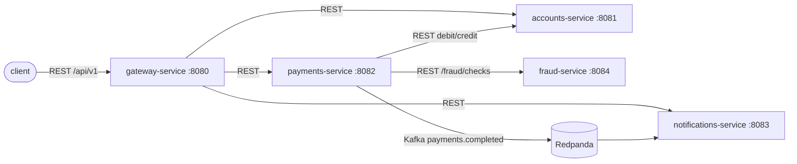

# demo-bank platform

A small, fictional banking system built as a realistic target for two AI-agent projects:

1. **Cross-repo impact analysis agent**: a code graph across all repos, exposed over MCP, answering "what breaks if I change X?" and opening coordinated PRs.
2. **Self-healing production agent**: detects, diagnoses and remediates incidents on a local Kubernetes cluster.

This repo holds the local runtime (Docker Compose) and scripts. Each service lives in its own repo on purpose: cross-repo dependencies are the point.

## Architecture



All services share DTOs and event contracts from `bank-contracts`.

| Repo | Responsibility |
|---|---|
| `bank-contracts` | Shared DTOs (`PaymentDto`, `AccountDto`, ...), `PaymentCompletedEvent`, topic names |
| `gateway-service` | Public API facade, no business logic |
| `accounts-service` | In-memory balances, debit/credit, overdraft and currency checks |
| `payments-service` | Orchestration: fraud check, debit, credit (with compensation), event publishing |
| `fraud-service` | Deterministic rule-based risk scoring |
| `notifications-service` | Consumes payment events, stores customer notifications |

Seeded accounts: `acc-alice` (12,000 CHF), `acc-bob` (500 CHF), `acc-carol` (2,000 EUR).

## Run it

Requires JDK 25, Maven and Docker.

```bash
./scripts/build-all.sh          # MVN=/path/to/mvn to override
docker compose up -d --build
./scripts/smoke-test.sh
```

Try it:

```bash
curl -s -X POST localhost:8080/api/v1/payments -H 'Content-Type: application/json' \
  -d '{"sourceAccountId":"acc-alice","targetAccountId":"acc-bob","amount":250,"currency":"CHF","reference":"rent"}'
curl -s localhost:8080/api/v1/accounts/acc-bob/notifications
```

Every service exposes `/actuator/health` and `/actuator/prometheus`.

## CI

Each repo has a GitHub Actions workflow. Service workflows check out `<owner>/bank-contracts` and install it before building, so the repos must live under the same GitHub owner.
